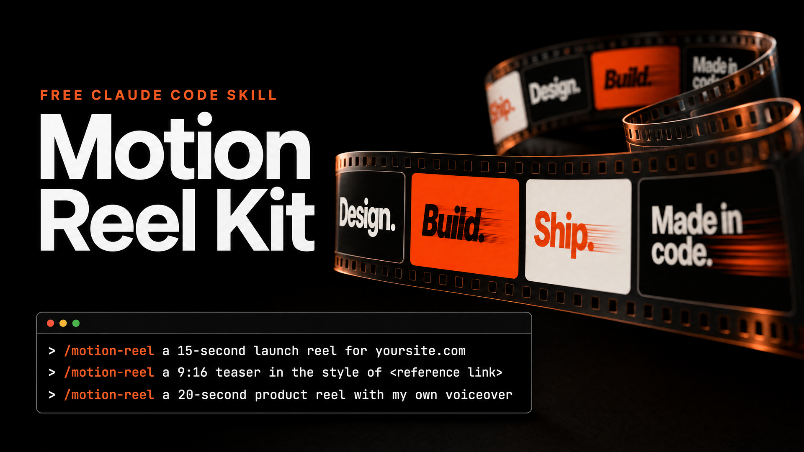

Get weekly updates on the latest AI workflows to 10x your productivity: https://www.weekly10x.com



# Motion Reel Kit

Beat-synced motion graphics made entirely in code, directed by Claude Code.

You describe the product. Claude captures the real brand from its site, writes a style guide and a shotlist, and waits for your OK. Then it builds the film as a pure function of time, with springs, a synthesized score and UI sounds on the measured beat grid. It critiques its own render until every score is 8 or higher, and exports H.264 in 16:9, 1:1, 4:5 and 9:16.

## What's inside

| | |
|---|---|
| `CLAUDE.md` | The motion rules: `seek(t)`, seeded noise only, no timers or CSS transitions in render mode, springs only, the banned-cliché list. |
| `.claude/skills/motion-reel/` | The `/motion-reel` skill: `SKILL.md`, the engine (`engine/index.html`, `core.js`, `type.js`, `lib/motion.js`), the pipeline scripts (`render.mjs`, `beats.py`, `sfx.mjs`, `music.py`, `mix.py`, `sync.mjs`, `capture.mjs`, `vo.py`, `review.py`, `preset.mjs`), the critique prompt (`reference/CRITIQUE.md`) and templates. |
| `presets/lukas-yt/` | A worked example preset: brand, colours, Geist font, 120 BPM, 16:9 + 9:16, own-voice narration, house notes. |
| `presets/blank/` | The same fields, empty, with a comment on every one. Copy it for your brand. |
| `prompts/` | Every chapter prompt in order (`01` to `14`), the director's brief as a fill-in-the-blanks template, and the critique scorecard. |
| `examples/` | A 5-second test render made by this kit with the blank preset. |
| `cover.png` | The kit cover (1920×1080). |
| `test-render.sh` | Smoke test: scaffolds a film and renders 5 seconds (`npm test`). |

## Quick start

**1. Install Node, ffmpeg and Playwright** (plus the Python audio libraries)
```bash
brew install node ffmpeg
```
```bash
npm install && npx playwright install chromium
```
```bash
pip3 install -r requirements.txt
```
On Windows or Linux, install Node 22+ and ffmpeg with your package manager. Python 3.9+ is needed for the score, the beat grid and the mix.

**2. Drop in the folder.** Open this folder in Claude Code, or copy `CLAUDE.md`, `.claude/`, `presets/` and `package.json` into your own project and run the install lines there.

**3. Type `/motion-reel`** and describe the film. Claude asks for anything that's missing, in one round.

## Example command

```text
/motion-reel 20-second launch reel for https://example.com in 16:9 and 9:16. Use presets/blank, synthesize the music, no voiceover.
```

## Get started prompts

Swap in your own site. Claude asks for anything missing in one round, then shows you a shotlist before it builds anything.

```text
/motion-reel a 15-second launch reel for https://yoursite.com
```
```text
/motion-reel a 9:16 teaser for https://yoursite.com in the style of <link to a launch video you love>. Take its rhythm and transitions, not its content.
```
```text
/motion-reel a 20-second product reel for https://yoursite.com with a voiceover in my own Fish Audio voice. Natural sentences only; never read the on-screen captions aloud.
```
```text
/motion-reel fill in presets/blank from https://yoursite.com (colours, fonts, promise, CTA), save it as presets/<my-brand>, then make a 15-second reel with it.
```
```text
/motion-reel critique the last render: contact sheet, phone test at 360 px, loop seam. Fix the 3 worst problems and repeat until every score is 8+.
```

To check your setup before the first real film, render the 5-second test:
```bash
npm test
```
It writes `videos/_test-<time>/renders/16x9.mp4`. To test a preset of your own: `sh test-render.sh presets/<your-brand> 5`.

## Make your own preset

1. Copy `presets/blank` to `presets/<your-brand>`.
2. Fill in `preset.jsonc`: product, URL, hook, CTA, colours, fonts (`.woff2` files you're allowed to redistribute), tempo, formats and voiceover.
3. Say "use presets/<your-brand>" when you run `/motion-reel`. The preset fills the brief, colour tokens, fonts and timeline, so Claude only asks about what's left.

## How a film gets made

1. **Intake:** brief, preset, missing inputs asked in one round.
2. **Assets:** real screenshots, logo, fonts and colours from the product URL (Playwright).
3. **Style guide:** palette, type and rhythm. From a reference film it takes the grammar, never the content.
4. **Beat grid:** original score synthesized in code, measured with librosa into `beats.json`.
5. **Shotlist:** then it **stops for your OK**.
6. **Build:** `window.seek(t)` scenes with closed-form springs, hits led to read on the beat.
7. **Critique loop:** contact sheets, fast-action strips, phone test at 360 px, loop seam. A fresh critic scores 8 criteria, and it fixes the 3 worst problems each round. At least 3 rounds, until every score is 8+.
8. **Finals:** 60 fps with motion blur, SFX, a -14 LUFS mix, every format.

Optional voiceover uses the Fish Audio MCP. Connect it in Claude Code first, and use your own cloned voice if you have one.

## Requirements

- Node 22+, ffmpeg, Playwright Chromium
- Python 3.9+ with numpy, scipy, soundfile, librosa and pillow (`requirements.txt`)
- Claude Code

The Geist font in `presets/lukas-yt/fonts` is under the SIL Open Font License (`OFL-Geist.txt`).
